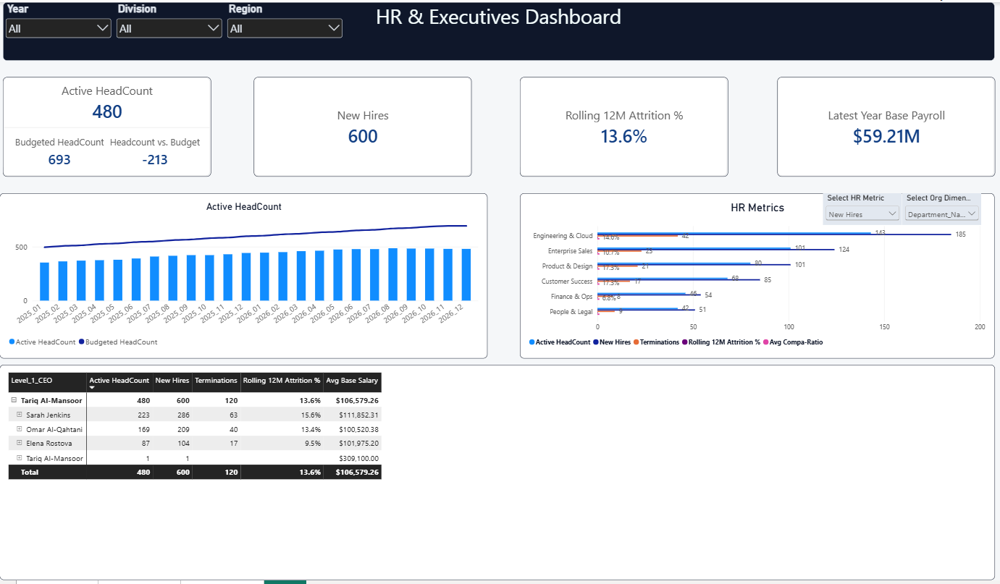
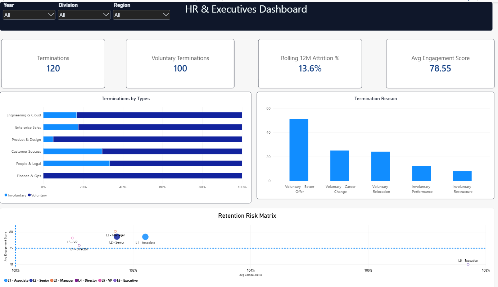
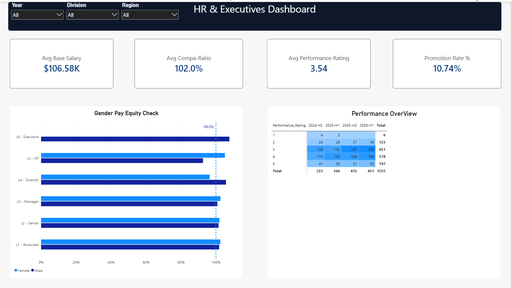
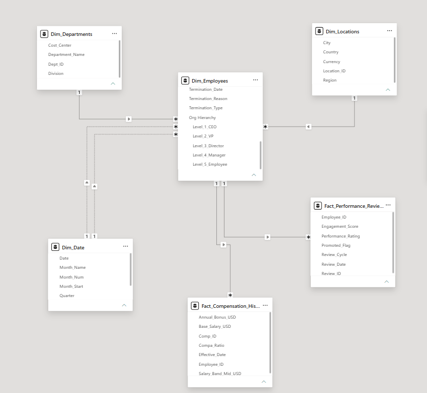

# Enterprise People Analytics & Workforce Intelligence (Power BI)

An end-to-end HR Business Intelligence solution modeling **Nexora Cloud** (600 employees across Riyadh, Dubai, London, and New York), built to track point-in-time headcount, annualized attrition, pay equity, and organizational hierarchy rollups.

## Dashboard Preview

### 1. Executive Workforce & Headcount Overview

### 2. Attrition Diagnostics & Retention Risk

### 3. Compensation Equity & Performance Calibration

### 4. Star Schema Data Model

## Data Modeling & Technical Architecture
- **Power Query ETL:** Standardized casing/whitespace on employee and termination attributes, resolved mixed currency/string formatting on salary records, and engineered a `Termination_Type` classification column.
- **Star Schema & Role-Playing Dates:** Modeled a conformed `Dim_Date` table with two inactive role-playing relationships (`Hire_Date` and `Termination_Date`) to avoid circular ambiguity.
- **Parent-Child Org Hierarchy:** Flattened 5 management tiers (`CEO` → `VP` → `Director` → `Manager` → `Employee`) using `PATH()`, `PATHITEM()`, and `COALESCE()`.
- **Dynamic Row-Level Security (RLS):** Secured employee records dynamically along the reporting tree via `PATHCONTAINS()` and `USERPRINCIPALNAME()`.
- **Disconnected Target Bridging:** Used multi-column `TREATAS()` to compare actual monthly headcount against `Targets_Headcount_Monthly`.

## Key Analytical Insights
- **Headcount & Growth:** Active headcount stands at **480** (`-213` vs. cumulative budget expansion targets), with **120** total terminations (`100` voluntary, `20` involuntary).
- **Primary Attrition Driver:** **Voluntary - Better Offer** accounts for the largest share of exits (~42%), concentrated most heavily in **Engineering & Cloud** and **Enterprise Sales**.
- **Pay Equity & Calibration:** Overall `Avg Compa-Ratio` stands at **102.0%** (`$107K` average base salary), with semi-annual performance ratings (`1,555` reviews) following a healthy bell-curve distribution (`3.54` average rating, `11.2%` promotion rate).
